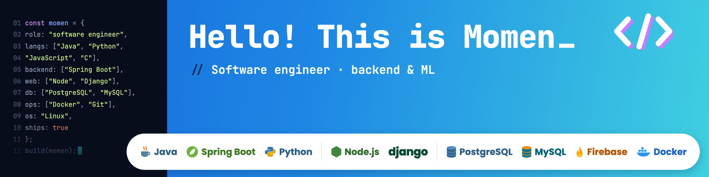

  

# Hello, I'm Momen 👋
### Software Engineer · Backend · ML Research

  

- 🎓 Final-year Software Engineering student at **Daffodil International University** (Data Science major)
- 💼 Backend Development Intern, Web Section, DIU
- 🛠️ Freelance full-stack developer: Spring Boot, MERN, Django
- 🔬 Research interests: explainable AI, NLP, bioinformatics

---

  

  
  

## 🧰 Tools and Technologies

### Programming Languages

### Backend

### Frontend

### Databases

### ML & Data Science

### Cloud & DevOps

### Testing & Tools

### IDEs & Editors

### Operating Systems

